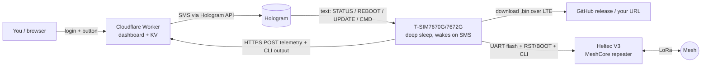
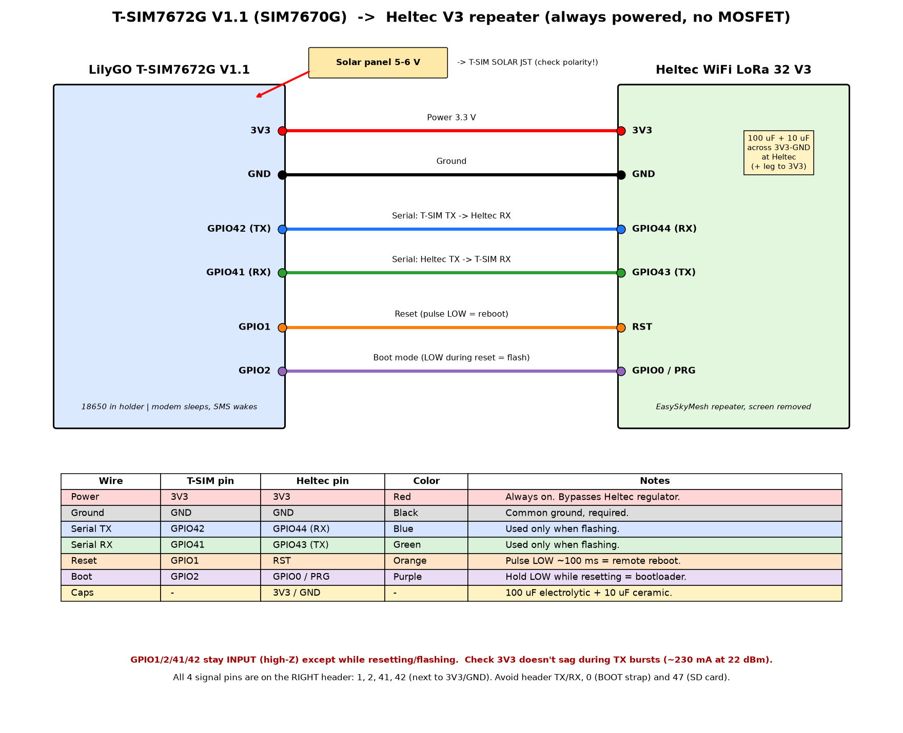

# T-SIM Remote Updater

A **solar-powered MeshCore repeater you can manage from anywhere**. A Heltec WiFi LoRa 32 V3 runs the repeater; a LilyGO T-SIM7670G / T-SIM7672G (ESP32-S3 + LTE modem) sits next to it in deep sleep and wakes only when it receives a text message. From a password-protected web dashboard (a free Cloudflare Worker) you can:

- request status (T-SIM battery/solar/signal plus a MeshCore mesh snapshot),
- reboot the Heltec,
- **reflash the Heltec over LTE** with the latest repeater firmware,
- optionally run repeater CLI commands,
- manage **many repeaters** from one fleet dashboard.

Nothing is texted on a schedule unless you turn it on. Since T-SIM firmware 1.7.1 the T-SIM also wakes itself every 3 hours (no text) to check that its modem is still on the network and recover it if not ([Modem watchdog](#modem-watchdog-self-recovery-t-sim-firmware-171)). Step-by-step setup: **[docs/SETUP.md](docs/SETUP.md)**. Using an AI agent to build it for someone? See **[docs/FOR-AI-AGENTS.md](docs/FOR-AI-AGENTS.md)**.

## How it works



1. You press a button; the Worker texts a short command to the SIM via the Hologram API.
2. The incoming SMS wakes the T-SIM (modem RI pin). It does the job, posts results to the Worker over HTTPS, then goes back to deep sleep.
3. The Heltec stays a normal standalone repeater; the T-SIM only touches it when asked.

## Parts list

| Part | Notes | Link |
|---|---|---|
| LilyGO T-SIM7670G-S3 (or T-SIM7672G V1.1, same pinout) | ESP32-S3 + LTE Cat-1, 18650 holder, solar input | [Amazon](https://link.amazon/B0declSh7) |
| Heltec WiFi LoRa 32 V3 (915 MHz for US) | Runs the MeshCore repeater firmware | [Amazon](https://link.amazon/B0czhvm4K) |
| Hologram SIM | Any plan; incoming SMS to the SIM is free | hologram.io |
| 18650 Li-ion cell, small 5–6 V solar panel, LTE + LoRa antennas, weatherproof box | | |
| GNSS (GPS) antenna, u.FL (optional) | Only for the location feature. Use an active GNSS patch antenna on the T-SIM's **GPS/GNSS** u.FL connector (not the LTE one), facing the sky | |
| 100 µF + 10 µF capacitors, 6 jumper wires | | |

*As an Amazon Associate I earn from qualifying purchases.*

## Wiring




**Recommended wiring (since Oct 2026):** the Heltec V3 is powered **directly from the same 1S Li-ion battery** through its own JST battery connector (both + and −). There is **no 3V3 link** between the boards. The T-SIM does the solar charging. The boards share GND and the four signal wires below. Benefit: the repeater measures and reports the **true battery voltage** over the mesh.

| Wire    | T-SIM side            | Heltec V3 side                 |
|---------|-----------------------|--------------------------------|
| Battery | battery + / − (18650) | JST battery connector + / −    |
| Ground  | GND                   | GND (shared)                   |
| Serial  | GPIO42 (TX)           | GPIO44 (RX)                    |
| Serial  | GPIO41 (RX)           | GPIO43 (TX)                    |
| Reset   | GPIO1                 | RST / EN                       |
| Boot    | GPIO2                 | GPIO0 / PRG                    |
| ~~3V3~~ | **not connected**     | **not connected**              |

- **Check the JST polarity with a multimeter before plugging in.** The Heltec battery socket is 1.25 mm pitch and JST battery-lead polarity is *not* standardized; a reversed lead can destroy the board.
- **Never plug USB into the Heltec while it is wired to the battery.** Its on-board charger would then charge the shared cell, in parallel with the T-SIM's charger. Unplug the battery lead first if you need Heltec USB.
- Put an inline **fuse on the battery +** lead (e.g. 2–3 A) close to the cell.
- Optional: **10 µF + 100 nF ceramic** capacitors across 3V3/GND on each board, close to the module.
- Optional: **1 kΩ series resistors** in the TX/RX lines to limit current if one board is unpowered or misconfigured.
- The T-SIM can **reset** the Heltec (RST line) but cannot **power-cycle** it, since the Heltec is fed straight from the battery.

On-board modem: TX11, RX10, PWRKEY18, RESET17, RI3 (wake), DTR9.


## Battery calibration and low-battery protection (T-SIM firmware 1.6.5+)

- **Idle battery reading:** the T-SIM samples its battery at the very start of each wake, before the modem is used, and reports that as the battery voltage. The reading with LTE running is shown separately as "Battery (LTE on)".
- **Calibration** (T-SIM tab › Battery calibration): enter a multimeter reading and the Worker computes a scale factor from the latest idle raw reading. You can also enter a scale/offset by hand, or reset. Settings are queued as a system command (`PWRCFG …`) that the T-SIM picks up at its next wake (Request status, console command or reboot), with no extra text. The T-SIM stores them in NVS. The repeater's own battery value is never calibrated.
- **Low-battery protection** (LoRa radio tab, off by default): when enabled, the T-SIM also wakes on a timer (default every 30 min) without starting LTE. It reads the idle battery and sends MeshCore `set repeat off` below the OFF level and `set repeat on` at/above the ON level, then verifies with `get repeat`. ON must be at least 10% higher than OFF (defaults 3.40 V / 3.75 V). The state is kept in NVS and reported at the next normal wake, or immediately if you enable that.


The Worker and dashboard don't care which board the repeater is. The T-SIM drives the repeater over 4 wires (TX, RX, RST, BOOT/GPIO0) plus GND. Remote flashing uses Espressif's ROM serial bootloader (esp-serial-flasher). Since v1.6.3 the T-SIM detects the chip after connecting, logs it ("Repeater chip detected: …"), and picks the write address.

Since v1.6.4 every radio update reports the detected chip, image type (merged / app-only / classic-merged), flash address, bytes written and the MD5 verify result to the dashboard (LoRa radio tab). After a successful flash the radio shows "Last flashed: <file> (awaiting repeater confirmation)" until a mesh poll reports the repeater's own version; then it shows "Up to date (vX, confirmed)", or a mismatch warning if the reported version differs from the flashed file.

| Repeater board | Remote flash | Reboot / status / console |
|---|---|---|
| **ESP32-S3** MeshCore boards (Heltec V3/V4, LilyGO T3S3, Station G2, Seeed Xiao S3, …) | ✅ Yes | ✅ Yes |
| **Classic ESP32** and **ESP32-C3** boards (also S2/C6, untested) | ✅ Yes | ✅ Yes |
| **nRF52** boards (RAK4631, LilyGO T-Echo, Heltec T114, Xiao nRF52840, Wio Tracker) | ❌ No: they use a UF2/DFU bootloader, not the ESP ROM bootloader | ✅ Yes, over serial + RST |
| Anything else (ESP8266, unknown) | ❌ Refused cleanly, nothing is written | depends on the board |

Only the Heltec V3 has been tested on real hardware. The other boards are expected to work from the code paths but are unverified.

**Wiring for other boards:** connect T-SIM TX→board RX, RX→TX, an RST pin to the board's EN/RST, BOOT to the board's **GPIO0** (S3/classic ESP32) or **GPIO9** (C3), and GND. Run it at 3.3 V logic. Pins are set in `firmware/src/board.h`.

**Pick the right firmware file for your board** (Settings → Heltec update source → *File name pattern* or *Direct URL*; presets fill these in for Heltec V3):
- Change the pattern to your board's file name, e.g. `Heltec_v3_repeater-*-upgrade.bin` → your board's equivalent from the same release.
- **App-only** file (no `merged`/`factory` in the name) is written at `0x10000` and keeps the repeater's identity and settings. Prefer this.
- **Merged/factory** file includes the bootloader + partition table and may reset identity. It is written at `0x0` (or `0x1000` for a classic-ESP32 image that starts with the bootloader).
- The T-SIM decides by reading the file contents (not the name), and refuses anything that isn't an ESP32 image or a classic-ESP32 image aimed at a different chip. It can't tell an S3 file from a C3 file, so make sure the file is for your board.

**T-SIM side:** the controller must be a **LilyGO T-SIM7670G / T-SIM7672G** (ESP32-S3 + SIM767x). The firmware's modem pins and AT commands are for that board. Other modems would need code changes.

## Modem watchdog: self-recovery (T-SIM firmware 1.7.1+)

The T-SIM sleeps until a text rings its modem. If the modem drops its LTE registration or hangs while the ESP32 sleeps, texts can't be delivered (Hologram holds them, with no "SMS delivered"), so nothing would ever wake the T-SIM again. Before 1.7.1 that needed a power cycle on site.

- **Timer wake** (default every **3 h**; 30 min to 24 h; off before 1.7.2, 24 h since). It doesn't reset the modem. It pulls DTR low to wake the modem from sleep, then checks that it answers `AT`, the SIM is ready (`AT+CPIN?`), it's registered (`AT+CEREG?` / `AT+CREG?`: home, roaming or SMS-only) and data is attached (`AT+CGATT?`). A healthy check takes a few seconds.
- **Recovery** (only when that check fails), with bounded timeouts and at most 5 minutes of recovery per wake:
  1. *Soft*: `AT+CFUN=0` then `AT+CFUN=1`, then up to 60 s for registration.
  2. *Hard*: `AT+CPOF` if the modem still answers, otherwise a 3 s PWRKEY pulse (GPIO18). Then the normal power-on: RESET (GPIO17, active low) for 2.6 s and a PWRKEY on-pulse, then up to 90 s for registration.
  3. Afterwards the SMS settings (`AT+CNMI` …) are set again so texts ring the T-SIM, and the modem goes back to sleep (`AT+CSCLK=1`, DTR held high) with the ring wake re-armed.
  - After a failure it retries sooner (30 min, 60 min, 2 h …, never longer than the interval). Below 3.35 V (idle battery) it only checks and skips recovery and the heartbeat.
- **Heartbeat**: after every check (default; turn it off to post only after a recovery or a failure), the T-SIM posts `{"type":"heartbeat"}` with its counters (checks, OK, soft, hard, failed), the last 6 recovery attempts and how many texts are stored on the modem. Each one is about 10–20 s of LTE and a few KB of data.
- **Logged in NVS** (namespace `tsimwd`): settings, counters and the last 6 attempts survive reboots and OTA.
- **Commands on watchdog wakes (1.7.2+)**: after a successful check the T-SIM fetches and runs queued dashboard commands once (`/commands?wd=1`, no retry, new commands stop after 2 min; skipped below 3.35 V; `WDCFG cmd=0` turns it off). A Heltec *Update radio firmware* is also queued as a watchdog-only backup copy (cancelled when the text starts the update, expires after 24 h). Watchdog wakes never send a text. Texts already stored on the modem only run on watchdog wakes with the setting *also run texts already waiting* (off by default).
- **Never stuck (1.7.2+)**: every sleep arms a timer (≤ 24 h; interval 0 now means 24 h). Every wake has an awake deadline (20 min, 45 min during an update) that restarts the ESP32, with the RTC hardware watchdog 60 s later as a backstop. After 3 failed recoveries in a row the T-SIM restarts completely (counted in NVS: `rst`, deadline/watchdog resets `dlx`).
- **Dashboard** (T-SIM tab › Modem watchdog): status, last check-in, next check, counters, last recovery, recent attempts and texts waiting. Settings (interval, heartbeat, stored texts) are queued as a `WDCFG int=<min> hb=0|1 sms=0|1` system command, only for T-SIM 1.7.1+, and applied at the next wake. The header badge says **Offline** and a red banner appears when the T-SIM misses 2 expected check-ins (+15 min grace). The expected interval is the watchdog interval the T-SIM reports, when heartbeats are on, or the scheduled check, whichever is shorter.
- USB serial `WDCHECK` runs one check by hand (bench test).
- The board has no switch that cuts power to the modem. If the modem ignores both RESET and PWRKEY, only a power cycle on site helps.

## Location / GPS (T-SIM firmware 1.6.7+, improved in 1.6.8)

The SIM7672G modem has a built-in GNSS receiver. It needs a **GNSS antenna on the T-SIM's GPS/GNSS u.FL connector**, ideally with a clear view of the sky. Without one you'll only see "no fix".

- **Get location** (T-SIM tab › Location): texts the T-SIM once (`CMD`). It picks up a `GPSFIX` system command, powers the GNSS antenna (`AT+CGDRT=4,1` + `AT+CGSETV=4,1`, modem GPIO4, as in LilyGO's GPS_BuiltIn example for this board), powers GNSS on (`AT+CGNSSPWR=1`, falling back to `AT+CGPS=1` on older SIMCom firmware), waits for `+CGNSSPWR: READY!` and confirms with `AT+CGNSSPWR?`, then polls `AT+CGNSSINFO` / `AT+CGPSINFO` until it gets a fix or hits the timeout (default 180 s, 30–600 s; the timer starts after READY). The first fix can take up to 5 min. GNSS then stays on for about 5 min so a retry is a warm start (the T-SIM wakes itself to switch it off; it is switched off at once while low-battery protection has the repeater off). The result includes diagnostics (READY wait, power check, antenna reply, GNSS mode, first/last raw `+CGNSSINFO`, satellites parsed), shown under GPS diagnostics in the Location card. The card shows the coordinates (with a Copy button), the fix time, the satellite count, accuracy (HDOP), altitude and a small OpenStreetMap map (Leaflet, no API key). If there's no fix it reports "no fix" with the number of satellites it saw, and keeps the last good fix. The button switches between Get location, Cancel and Retry, and a second press while a request is running sends nothing.
- **Auto-update location on check-in** (Location settings, off by default): when this is on, every `STATUS` check-in also runs a fix. Each one keeps GNSS on for up to the timeout, so it costs battery. Settings are sent as a `GPSCFG` system command at the next wake, without a text.
- **Set repeater location** (LoRa radio tab › Settings, optional): after you confirm, it sends the MeshCore CLI commands `set lat <deg>` and `set lon <deg>` with the latest fix to the repeater and shows its replies. It never runs automatically.
- **Privacy:** coordinates and the map are blurred by default. The eye button shows them, and the dashboard remembers your choice in this browser, the same way as the cellular IP. The location is stored in the Worker's KV for your devices only. The map loads tiles from openstreetmap.org, so OSM sees the map area you view. Once you set it on the repeater, the position goes out in its adverts and anyone on the mesh can see it.

## Repeater firmware: MeshCore + power saving

The dashboard's default Heltec update source is the power-saving MeshCore build: [just-stuff-tm/MeshCore](https://github.com/just-stuff-tm/MeshCore), branch [`powersaving`](https://github.com/just-stuff-tm/MeshCore/tree/powersaving) (MeshCore + EasySkyMesh power saving, with serial.ondemand and headless Heltec V3 builds). Downloads are on its [releases page](https://github.com/just-stuff-tm/MeshCore/releases) (`vX.Y.Z-powersaving`); the dashboard picks the app-only `Heltec_v3_repeater-vX.Y.Z-powersaving-<commit>.bin` from the latest release, never `-merged` or `_headless`. serial.ondemand keeps the repeater's serial CLI reachable from the T-SIM while power saving is on.

For the first install over USB with the [MeshCore web flasher](https://flasher.meshcore.io) (Chrome or Edge, **Custom Firmware**; which file to pick for ESP32 and nRF52, headless builds, first commands), see [How to flash](https://github.com/just-stuff-tm/MeshCore/blob/powersaving/serial/README.md#how-to-flash). After that, **Check for updates** and **Update Heltec** in the dashboard install new releases over LTE.

## Costs and notes

- **Incoming SMS is free** on Hologram. The Worker sends each text through the Hologram API; for outgoing SMS costs see [Hologram's current pricing](https://www.hologram.io/pricing). **The T-SIM never sends SMS**, it reports over data only.
- Each wake uses a few KB of data (a firmware update ~1–2 MB). Cloudflare Workers + KV free tier is plenty.
- The T-SIM battery reads **0 V while USB is plugged in** (board design); unplug USB to see real values.
- **Works with other MeshCore repeater firmware**, not just EasySkyMesh: the CLI reads use standard MeshCore commands, unknown ones are skipped, and the update source (GitHub repo + filename pattern, or a direct URL) is editable per repeater.
- The scheduled check / hourly cron is **optional**: with every schedule off it sends nothing. You can delete the `[triggers]` block from `wrangler.toml` to remove it entirely.

## Reference: deploy the Worker

Requires a Cloudflare account and Node.js.

```bash
cd worker
npm install
npx wrangler kv namespace create STATE        # paste the id into wrangler.toml
npx wrangler secret put HOLOGRAM_API_KEY      # Hologram dashboard > Account > API
npx wrangler secret put ADMIN_TOKEN           # openssl rand -hex 32
npx wrangler secret put SESSION_SECRET        # openssl rand -hex 32
# optional: npx wrangler secret put GITHUB_TOKEN  (avoids GitHub API rate limits)
npm test                                      # local harness, mocks everything
npx wrangler deploy
```

## Reference: add a device

Find the SIM's numeric **device id** in the Hologram dashboard, then:

```bash
curl -X POST https://<your-worker>/admin/devices \
  -H "Authorization: Bearer $ADMIN_TOKEN" -H "Content-Type: application/json" \
  -d '{"id":"tsim-1","name":"My repeater","hologram_device_id":"1234567"}'
```

The response contains a generated **password** (for the dashboard) and an **ingest_key** (for the T-SIM firmware). They're shown once.

Other admin routes (all need `Authorization: Bearer <ADMIN_TOKEN>`):

| Method | Path | Does |
|---|---|---|
| GET | `/admin/devices` | list devices (no secrets) |
| DELETE | `/admin/devices/<id>` | remove device and its data |
| POST | `/admin/devices/<id>/reset-password` | new password (body `{"password":"..."}` optional); logs out existing sessions |
| POST | `/admin/devices/<id>/rotate-key` | new ingest_key (rebuild firmware) |

### Fleet login (one password for many repeaters)

```bash
curl -X POST https://<your-worker>/admin/accounts \
  -H "Authorization: Bearer $ADMIN_TOKEN" -H "Content-Type: application/json" \
  -d '{"id":"owner","name":"My repeaters","devices":["tsim-1","tsim-2"]}'
```

Log in with `owner` and the returned password to get the fleet page. Per-device passwords keep working and only open their own repeater.

| Method | Path | Does |
|---|---|---|
| GET | `/admin/accounts` | list fleet logins (no secrets) |
| PUT | `/admin/accounts/<id>` | `{"devices":[...]}` change which repeaters it covers |
| POST | `/admin/accounts/<id>/reset-password` | new password; logs out its sessions |
| DELETE | `/admin/accounts/<id>` | remove the fleet login |

## Reference: build and flash the T-SIM

```bash
cd firmware
cp include/config.example.h include/config.h   # set WORKER_URL, DEVICE_ID, DEVICE_KEY, APN
pio run                                         # first build installs + patches libraries
pio run -t upload --upload-port /dev/ttyACM0    # hold BOOT, tap RST, release BOOT first
```

Or with esptool:

```bash
esptool.py --chip esp32s3 --port /dev/ttyACM0 --baud 921600 write_flash -z \
  --flash_mode dio --flash_freq 80m --flash_size 16MB \
  0x0 .pio/build/tsim7672g/bootloader.bin 0x8000 .pio/build/tsim7672g/partitions.bin \
  0xe000 ~/.platformio/packages/framework-arduinoespressif32/tools/partitions/boot_app0.bin \
  0x10000 .pio/build/tsim7672g/firmware.bin
```

After RST the T-SIM stays awake for 2 minutes (USB serial commands at 115200: `STATUS`, `MESH`, `CMD`, `CLI <command>`, `REBOOT`, `TESTDL <url>`, `UPDATE <url>`, `TSIMUPDATE <url> [sha256:…]`, `WDCHECK`, `LASTLOG`, `SLEEP`, `STAY`), then sleeps until a text arrives or the watchdog timer fires.

### Partition layout and OTA (v1.6.0)

`partitions.csv` (16 MB flash): `nvs` 0x9000, `otadata` 0xe000, `app0` 0x10000 and `app1` 0x1F0000 (1.875 MB each), `spiffs` (LittleFS, ~12.2 MB, for downloaded Heltec images) at 0x3D0000. Going from an older single-app layout to this one needs **one USB flash** of all four files (bootloader, partitions, boot_app0, firmware). After that, T-SIM updates can go over the air. LittleFS is reformatted once, which only loses the saved last-update result.

The config from `include/config.h` (Worker URL, device id, device key, APN) is saved to NVS on first boot. Release builds from CI use the placeholder `config.example.h` and read the real values from NVS, so public release `firmware.bin` files work over the air on any T-SIM that has run a correctly configured ≥ 1.6.0 build once. Tagging `v*` makes CI attach `firmware.bin`, `firmware.bin.sha256`, `bootloader.bin`, `partitions.bin` and `boot_app0.bin` to a GitHub release.

### Library patches

- `lib/esp-serial-flasher`: Espressif esp-serial-flasher, vendored with an Arduino UART port, used to flash the Heltec.
- `patches/`: patched ESP_SSLClient 3.1.3 headers. They're copied over the downloaded library automatically by `apply_patches.py` (PlatformIO pre-script). See `patches/README.md`.

## Using the dashboard

Open your Worker URL and log in with a device id or fleet login and its password. A fleet login opens **/fleet**: one card per repeater with online/stale, last seen, battery, signal, Heltec firmware, neighbor count, packet counts, schedule and console state. Tap a card for the repeater page (**/d/&lt;id&gt;**).

The repeater page shows firmware, last seen (with a **stale** badge after 26 hours, or **Offline** when the T-SIM misses 2 expected watchdog/scheduled check-ins), wake cause, uptime, battery and solar, signal (CSQ/RSRP/RSRQ), operator, IP, the Heltec firmware, the latest `upgrade.bin` on GitHub, and an activity log. It refreshes every 30 s.

**Update source** (per device, in the dashboard): GitHub repo (default `just-stuff-tm/MeshCore`), asset filename pattern (`*` = anything, default `Heltec_v3_repeater-v*-powersaving-*.bin`: releases `vX.Y.Z-powersaving` and the older release names from before the rename; `-merged` and `_headless` files are skipped; a source saved with the old default pattern is updated once), an optional direct `https://` URL, or an uploaded file (see below). Update status compares like with like: firmware family (stock MeshCore, MeshCore + power saving, EasySkyMesh PowerSaving), MeshCore base version and build commit. A repeater running a different family from the selected source shows *Update available (different firmware source)*. When the GitHub source is turned off, Check and Update use the direct URL, or are disabled if it's empty.

**Mesh** section: repeater name, firmware, clock, the Heltec's own battery and uptime, radio (noise floor, last RSSI/SNR, airtime), packet counters and a neighbors table (id, SNR, last heard), from the latest snapshot.

**Scheduled check** (optional, off by default): 6 h, 12 h, daily or weekly. An hourly Worker cron texts STATUS only to repeaters whose check is due. Each check costs one incoming text and wakes the T-SIM for a minute or two.

**Repeater console** (optional, off by default, per repeater): type a MeshCore CLI command (`ver`, `neighbors`, `stats-packets`, `get name`, `advert`, `set ...`). Commands queue on the Worker; **Queue & wake** texts `CMD` to the T-SIM, which fetches them (`GET /api/dev/<id>/commands` with its key), runs each on the Heltec serial CLI and posts the output back. Commands that can wipe or detach a repeater (`erase`, `start ota`, `password`, radio `set`s, …) need an extra confirm. Turning the console off cancels anything queued, and the T-SIM gets no commands while it's off.

**Power saving:** some repeater firmware power-saving modes (e.g. EasySkyMesh `powersaving on`) put the ESP32 to sleep and block the serial CLI. The dashboard marks a repeater as in power saving when `powersaving on` succeeds or the last CLI attempt got no reply; the console and mesh polling are then paused (the last snapshot stays visible). Any successful CLI reply, or `powersaving off`, re-enables them. Firmware without a power-saving command simply keeps the console enabled. Repeater stats can still be retrieved over the mesh using MeshCore remote admin (e.g. from the MeshCore app). T-SIM stats (signal, battery, solar, modem) are still available here via Request status.

**T-SIM firmware** card and **T-SIM firmware update** panel (T-SIM firmware ≥ 1.6.0): shows the running T-SIM version, the latest available and the last OTA result. Source: GitHub releases of a repo (default `just-stuff-tm/tsim-remote-updater`, asset `firmware.bin`) or a direct `https://` URL, plus an optional SHA-256/MD5 checksum (if empty, GitHub's asset digest is used). **Update T-SIM firmware** queues `TSIMUPDATE <url> <checksum>` as a system command (delivered even when the repeater console is off) and texts `CMD`. The T-SIM downloads the image, checks size, ESP32 image header and checksum, writes the spare app slot, and reboots. The new firmware only marks itself good after it has posted to the dashboard; otherwise it rolls back to the previous version.

**Layout:** a sticky header with the repeater name and Online/Stale badge, one row of main actions (**Request status**, **Check for updates**, **Update Heltec**, **Update T-SIM**, **Reboot Heltec**), then **Overview** (T-SIM, power, cellular), **Updates** (Heltec and T-SIM firmware with progress), **Mesh**, **Settings** (collapsible: Heltec update source with firmware presets, T-SIM firmware source, scheduled check, console) and **Activity** (collapsible). Buttons show plain-language messages (e.g. "Text sent. The T-SIM will wake and report within ~2 minutes.") instead of raw responses. Texts are limited to one per 60 s per device.

**Update progress:** each update gets a progress bar and step list (Waiting for T-SIM to wake, Downloading, Verifying, Writing / flashing, Rebooting, Done/Failed) with times, the target file and a plain-English failure reason. It's built from the events the firmware already posts (`UPDATE start`, `Download done`, `SUCCESS`/`FAIL` for the Heltec; `TSIM OTA start / downloaded / written / OK / FAIL` for the T-SIM). The page refreshes every 5 s while an update runs, and an update with no result after 15 minutes is shown as "No response". Fleet cards show a small badge while an update is running or just finished.

**Firmware presets** (Heltec update source): *MeshCore + power saving* (default; GitHub `just-stuff-tm/MeshCore`, branch `powersaving`, `Heltec_v3_repeater-v*-powersaving-*.bin`; features serial.ondemand and headless Heltec V3 builds), *EasySkyMesh PowerSaving* (GitHub `IoTThinks/EasySkyMesh`, `Heltec_v3_repeater-*-upgrade.bin`) or *Stock MeshCore repeater* (a direct link to the official `meshcore-dev/MeshCore` app-only image `Heltec_v3_repeater-v<ver>-<hash>.bin`; the newest release of that repo is often a companion build, so the preset uses a direct link). Use the non-`merged` file to keep the repeater's identity.

**Safety check:** T-SIM firmware before 1.6.2 decided "merged image" by file name or by "starts with 0xE9 and is over 1 MiB", so current app-only Heltec V3 images (EasySkyMesh `upgrade.bin` ~1.19 MB, stock MeshCore ~1.17 MB) would be written at 0x0 over the Heltec's bootloader. From 1.6.2 the T-SIM ignores the file name: an image is merged only if it has a partition table (0xAA 0x50) at 0x8000 (or an app header at 0x10000 after an erased gap) and goes to 0x0; an app-only image (0xE9 at offset 0) goes to 0x10000; anything else is refused. While a device reports T-SIM firmware older than 1.6.2, **Update Heltec** checks the file first and refuses app-only images over 1 MiB.

### Upload a firmware file (from a PC or phone)

Radio tab → Firmware → **Upload firmware file**: pick a Heltec V3 `.bin` and press **Upload**. The Worker checks it (ESP32 image byte `0xE9`, built for ESP32-S3, fits the Heltec's 3.19 MB app partition, max 4 MB, same app-only / merged rules as the T-SIM firmware) and shows its size, SHA-256 and MD5. Up to 3 files per device are kept in the Worker's KV; each has a **Delete** button. Press **Use for Update** on a file, then the usual **Update radio firmware** button (same confirmation as before) texts the normal `UPDATE <url>` command with the file's link, `https://<worker>/fw/<32 hex chars>` (no underscores, so it survives SMS). Nothing is sent when you upload or select a file. The download link serves the exact bytes with a correct `Content-Length` (single `Range` requests also work). The `UPDATE` text carries no checksum; the T-SIM verifies the written flash with MD5, and the dashboard shows a ✓ when the flash MD5 matches the uploaded file. **Use the GitHub release instead** switches back.

**Merged / fresh-install images** (detected from the contents: partition table at 0x8000 or 0x7000, or an app at 0x10000 behind erased flash; or from a `-merged` / `freshInstall` / `factory` file name) are accepted but **erase the Heltec's identity (private key), name, settings, passwords, ACL and regions**. Selecting one needs a confirmation, and Update shows a red warning with a one-click backup link, a required acknowledgement checkbox and the word **ERASE** typed in (the Worker enforces the same check).

### Repeater backup and restore

Settings → **Repeater backup & restore**:
- **Create backup & download** saves a JSON file with every repeater setting the dashboard has read (Read all, or the T-SIM settings cache): name, radio, TX power, advert intervals, routing, power saving, GPS, bridge, guest password and so on, plus regions, the access list (ACL) and this dashboard's per-device config (update source, T-SIM firmware source, schedule, console, power / GPS / cache settings, nicknames). Backups never contain the dashboard passwords, device ingest key, Hologram key or any Worker secret. The last 5 backups are kept on the Worker with Download / Delete.
- **Read private key for backup** (behind a confirmation, texts the T-SIM once) runs `get prv.key` on the repeater's serial console. The key is stored hidden on the Worker (never shown in history or activity) until **Forget stored key**. Tick **Include the private key** to put it in a backup; such files are marked **SENSITIVE**.
- **Restore**: pick a backup file to see the differences from the current values, tick the groups (dashboard config, repeater settings, regions, ACL, identity), and press **Restore selected**. Dashboard config is applied at once. Repeater changes are staged as the matching CLI commands (`set ...`, `region put/allowf/home/default` + `region save`, `setperm`, and for identity `set prv.key` followed by `reboot`). Nothing is sent until you press **Send part N**, which queues one wake's worth (up to 40 commands / 6000 bytes) and texts the T-SIM once. Larger restores are split into parts. Risky changes need a confirmation, and identity needs **IDENTITY** typed in. Regions and ACL entries that aren't in the backup are kept, not removed.

### Power-saving settings (Repeater settings → Power & battery)

Each has a Read button and is included in Read all, the T-SIM settings cache, the console's command picker and backups / restores. Syntax is taken from the firmware source (just-stuff-tm/MeshCore branches `powersaving` and `powersaving-port`). Stock firmware answers `??:` / `Unknown command`, shown as *Not supported by this firmware*.

| Setting | Read | Save |
|---|---|---|
| Power saving | `powersaving` | `powersaving on` / `powersaving off` (risky: confirmation) |
| Serial on demand | `get serial.ondemand` | `set serial.ondemand on` / `set serial.ondemand off` (off is risky: with power saving on, the T-SIM may no longer reach the Heltec's CLI) |
| RX duty cycle | `get radio.rxps` | `set radio.rxps off` / `set radio.rxps level <1-10>` (3 = on/conservative, 6 = balanced, 8 = max; 9 overdrive and 10 riskyWorkingMax need confirmation). Custom `set radio.rxps <rx_us> <sleep_us>` is console-only |
| Scheduled reboot | `get reboot.interval` (`disabled` = 0) | `set reboot.interval <0-255>` hours, 0 = off |
| Reset reason (Diagnostics) | `powerlog` | read-only |

## SMS commands (what the Worker sends)

| Text | Effect |
|---|---|
| `STATUS` | T-SIM posts full telemetry plus a mesh snapshot to the dashboard |
| `CMD` | T-SIM fetches queued console commands, runs them on the Heltec, posts outputs and a mesh snapshot |
| `REBOOT` | pulses Heltec RST |
| `TSIMUPDATE <url> [sha256:<hex>\|md5:<hex>]` | T-SIM self-update (OTA with rollback, ≥ 1.6.0). The dashboard sends this through the `CMD` queue, because a URL plus checksum doesn't fit in one text |
| `WDCFG int=<0\|30-1440> hb=0\|1 sms=0\|1 [cmd=0\|1]` | Modem watchdog settings (≥ 1.7.1; `cmd` and int 0 = 24 h since 1.7.2). A system command queued by the dashboard and picked up at the next wake; never texted |
| `GPSFIX` / `GPSCFG auto=0\|1 to=<s>` | T-SIM location fix / location settings (≥ 1.6.7). Never texted directly: the dashboard queues them as system commands and wakes the T-SIM with `CMD` (or they ride along with the next `STATUS`) |
| `UPDATE <https-url>` | downloads the `.bin` over LTE, flashes the Heltec, verifies MD5, resets it |

Underscores in URLs are sent as `%5F` because SMS (GSM-7) can drop `_`. Use `*-upgrade.bin` images (they keep the repeater's identity). `freshInstall-merged.bin` images wipe its name, keys and settings. Any other text is ignored. The T-SIM never sends texts.

## Security notes

- Each device has its own dashboard password (PBKDF2-SHA256, 100k iterations, random salt) and its own ingest key. Fleet logins are hashed the same way and only open the devices listed for them. A session cookie (HMAC-signed, HttpOnly, Secure, SameSite=Strict, 7 days) is only valid for that device or fleet. Dashboard POSTs reject cross-origin requests. Failed logins are limited to 5 per 15 min per IP and device.
- The T-SIM only holds its ingest key, so it can only post telemetry and fetch console commands for itself. The admin token never leaves your machine.
- **SMS commands are not authenticated.** Anyone who knows the SIM's number or can text it can reboot or reflash the repeater. Keep the number private. Hologram SIMs without a phone number can only be texted through your Hologram account.
- Never commit `firmware/include/config.h` or any token. `.gitignore` covers the usual files.

## License

MIT
